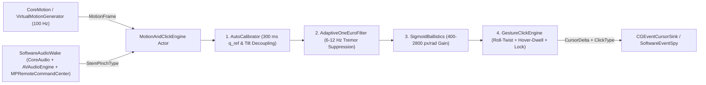

# AirPodWand

**Pure-Software macOS 6-DoF AirPods Cursor Controller & Gesture Engine (Swift 6)**

AirPodWand transforms AirPods 4 (and compatible CoreMotion headphones) into a precision handheld 3D wand/mouse driver on macOS—implemented purely with native Apple SDK frameworks and **zero external SPM dependencies**.

---

## Architecture



### Package Targets (`Package.swift`)
- **`AirPodWandCore`** (`Sources/AirPodWandCore/`):
  - `Domain/`: `MotionFrame`, `CursorDelta`, `ClickType`, `ClickEvent`, `EngineConfig`, `SimulationResult`, `RecordedClick`.
  - `Protocols/`: `MotionSourceProtocol`, `AudioWakeProtocol`, `StemPinchHandling`, `CursorEventSink`.
  - `Audio/SoftwareAudioWake.swift`: `AudioAutoRouter`, `MockAudioHardwareProvider`, `SystemAudioHardwareProvider`, `AudioBufferSynthesizer`, and `SoftwareAudioWake` (CoreAudio routing, fallback restoration, sub-audible 20 Hz `AVAudioSourceNode`, `MPNowPlayingInfoCenter`, `MPRemoteCommandCenter` stem hooks).
  - `Motion/`: `AutoCalibrator`, `AdaptiveOneEuroFilter` (`OneEuroFilter`), `SigmoidBallistics`, `GestureClickEngine` (`RollTwistClickDetector`, `HoverDwellClickDetector`), `MotionAndClickEngine`, `HeadphoneMotionSource`.
  - `Cursor/CGEventCursorSink.swift`: WindowServer cursor warping & quartz event dispatch with display clamping, click history ring buffer, and zero-wander lock suppression.
  - `Simulation/VirtualSimulator.swift`: `VirtualMotionGenerator`, `SoftwareEventSpy`, `MockAudioWake`.
- **`AirPodWandCLI`** (`Sources/AirPodWandCLI/`):
  - `main.swift`: CLI parser (`--simulate-e2e`, `--live`, `--help`/`-h`).
  - `SimulationRunner.swift`: Headless closed-loop verification runner (`--simulate-e2e`).
  - `LivePipeline.swift`: Live orchestrator wiring `SoftwareAudioWake` (`StemPinchHandling`), `HeadphoneMotionSource`, `MotionAndClickEngine`, `CGEventCursorSink`, and `SignalTrap`.
  - `SignalTrap.swift` & `Info.plist` (linked into Mach-O `__TEXT,__info_plist` for macOS Motion TCC).
- **`AirPodWandTests`** (`Tests/AirPodWandTests/`): Comprehensive multi-tier verification, stress, concurrency, and adversarial test suites.

---

## Pure-Software Verification & Usage

### Run All Tests (Debug + Strict Concurrency)
```bash
swift test -Xswiftc -warnings-as-errors
```

### Run ThreadSanitizer Concurrency Audit
```bash
swift test --sanitize=thread
```

### Run Headless Closed-Loop E2E Simulation
```bash
swift run AirPodWandCLI --simulate-e2e
```
Expected exit code `0` with `E2E_SOFTWARE_VERIFICATION_PASSED`, bounded trajectory RMSE `<= 3.5 px`, cross-axis coupling `< 2.0%`, `0.0000 px` locked wander, and `3` verified gesture clicks (`hover_dwell`, `roll_twist_cw`, `roll_twist_ccw`).

### Build Release Binary & Verify Embedded Motion TCC Metadata
```bash
swift build -c release -Xswiftc -warnings-as-errors
otool -P .build/release/AirPodWandCLI
.build/release/AirPodWandCLI --help
```

### Live Hardware Mode (Single Right AirPod Supported)
> Requires paired AirPods supporting `CMHeadphoneMotionManager` (AirPods 4 / AirPods Pro 2 / Max) on macOS, plus Motion & Accessibility permissions on first launch.

```bash
.build/release/AirPodWandCLI --live
```

#### How to Hold Only the Right AirPod
1. Pinch the earbud body lightly between your thumb and index finger so **your skin touches the small black optical in-ear sensor** on the inner side (this keeps the AirPod H2 motion chip active out of the ear).
2. Let the stem point **downward toward your desk** (angled ~20–30° forward toward the display), using small wrist rotations like a laser pointer.
3. Follow the 2-step calibration printed in terminal (~0.5 s total):
   - **Step 1 (`[Calibration 1/2]`)**: Hold steady for `0.25 s` so Earth gravity locks horizontal left/right without inversion.
   - **Step 2 (`[Calibration 2/2]`)**: Gently tilt the top/earbud slightly **upward** toward the top edge of your screen once to lock your grip's Up/Down pitch axis.

#### Live Tuning Flags & Controls
```bash
.build/release/AirPodWandCLI --live --sensitivity 1.25 --no-dwell
```
- `--sensitivity <0.1..5.0>`: Adjust cursor speed multiplier (display width auto-scales automatically; default `1.0`)
- `--quick-calibrate`: Skip Step 2 upward tilt and lock right after `0.25 s` stillness
- `--invert-x` / `--invert-y`: Flip horizontal or vertical cursor direction manually
- `--no-dwell`: Disable hover-dwell auto-clicking while keeping stem & roll-twist clicks active
- **Single Stem Pinch** (`togglePlayPauseCommand`): Left click (`stem_single_pinch`)
- **Double Stem Pinch** (`nextTrackCommand`): Right click (`stem_double_pinch`)
- **Triple Stem Pinch** (`previousTrackCommand`): Trigger fresh 2-step recalibration if you change grip
- **Axial Roll Twist**: Clockwise (`> +4.2 rad/s`) = left click; Counter-Clockwise (`< -4.2 rad/s`) = right click
- **Hover-Dwell**: Approach `>= 25 px`, hold steady inside `4.5 px` radius for `550 ms` = left click (disabled with `--no-dwell`)

---

## Workflows
Multi-agent verification and execution workflows live under [`.agents/workflows/`](file:///Volumes/SeaGate/airpods_or_mouse?/.agents/workflows/):
- [`build-and-verify.md`](file:///Volumes/SeaGate/airpods_or_mouse?/.agents/workflows/build-and-verify.md)
- [`simulate-e2e.md`](file:///Volumes/SeaGate/airpods_or_mouse?/.agents/workflows/simulate-e2e.md)
- [`tsan-audit.md`](file:///Volumes/SeaGate/airpods_or_mouse?/.agents/workflows/tsan-audit.md)
- [`live-driver.md`](file:///Volumes/SeaGate/airpods_or_mouse?/.agents/workflows/live-driver.md)
